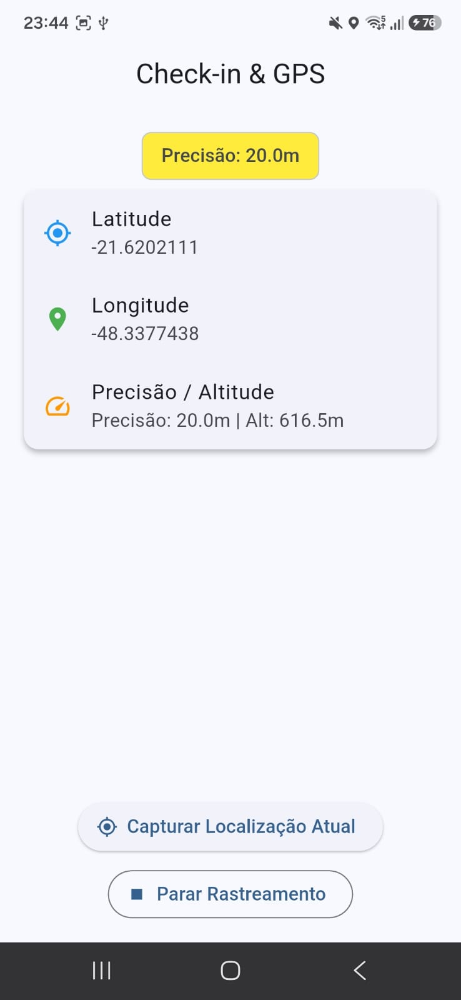
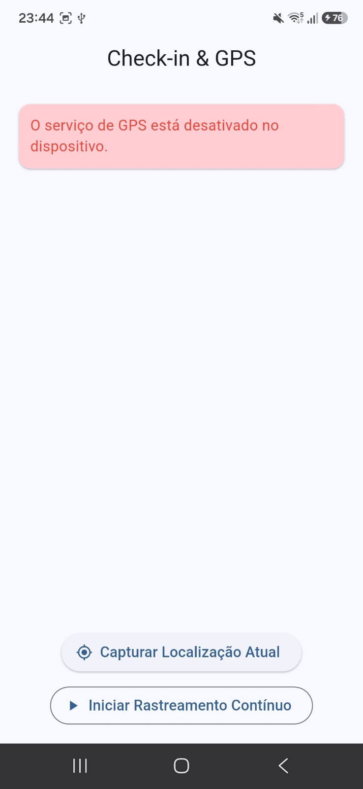

# Aula 14 - Geolocalização e GPS (Flutter)

Aplicativo desenvolvido na disciplina de Programação para Dispositivos Móveis I utilizando o pacote `geolocator` e o Desafio Básico (Medidor de Precisão com `Chip`).

## Prints de Funcionamento

### Captura, Rastreamento e Chip de Precisão

### Tratamento de Erro (GPS Desativado)
